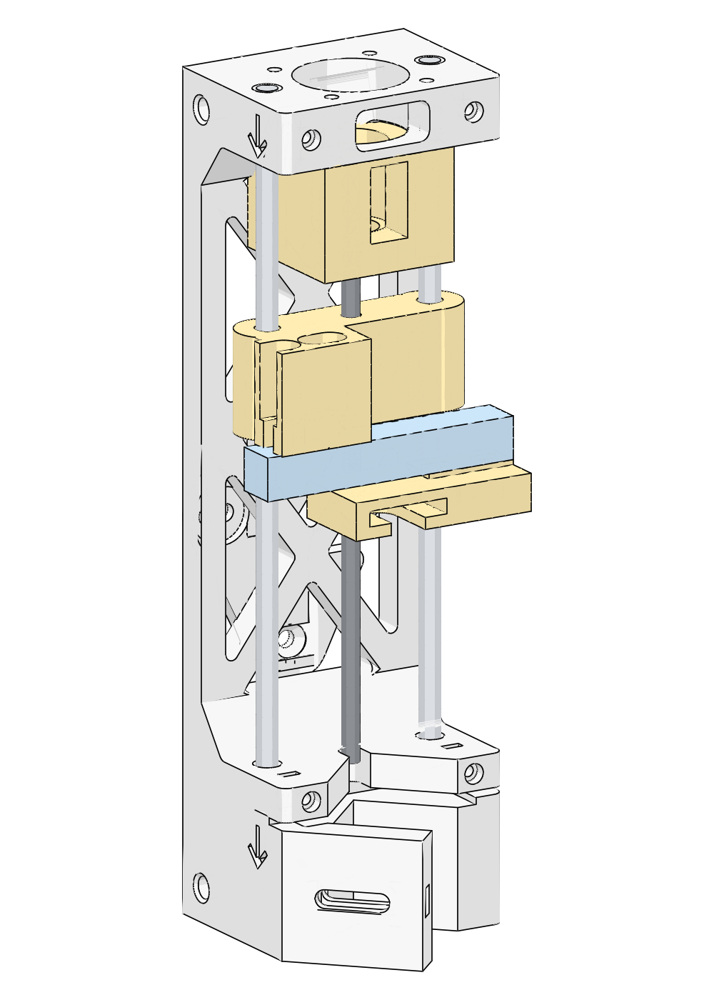
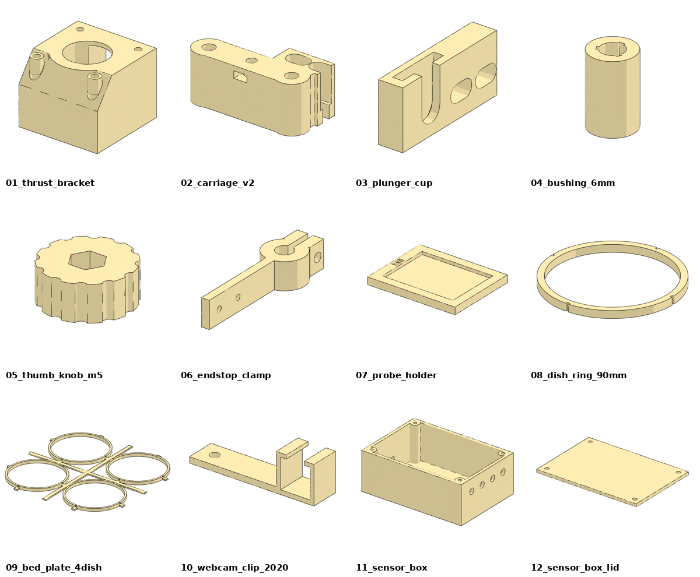

# Slurry bioprinter v2 (India build)

A redesign of the Ender 3 + syringe-pump slurry bioprinter in this repository, aimed at
**anyone in India building it cheaply**, mostly from second-hand parts, with sensors that
plug into **the computer that already drives the printer** (no Raspberry Pi).



| Start here | What it is |
|---|---|
| [BUILD_GUIDE.md](BUILD_GUIDE.md) | 10 phases, in order, each with a pass/fail check |
| [BOM_INDIA.md](BOM_INDIA.md) | parts with INR prices, Indian shops, and the used / scrap route for each |
| [stl/](stl/) | 12 new printed parts, ready to slice ([PRINT_LIST.md](stl/PRINT_LIST.md)) |
| [electronics/](electronics/) | Arduino Nano sensor box, wiring, watchdog for OctoPrint, optional Klipper config |
| [gcode/](gcode/) | the original test prints with the heater lines removed |
| [cad/](cad/) | the Python source for every part (`parts_v2.py`), the fit check and the exporter |



## Levels
- **Level 0, a working pump:** original body + thrust bracket, new carriage, plunger cup. About ₹13,500 with a used printer.
- **Level 1, it watches itself:** load cell (clog / empty detection), end switch, needle-touch Z probe, auto-pause through OctoPrint. About ₹700 more.
- **Level 2 / 3** (camera checks, multi-dish runs, closed-loop pressure) build on the same sensor box and are described in the v2 plan document; the webcam clip and 4-dish bed plate are included here.

## Rebuild the STLs
```
pip install trimesh manifold3d numpy matplotlib
python v2/cad/check_fit.py     # collision check against the original body
python v2/cad/build_all.py     # writes v2/stl/*.stl and v2/img/*.png
```

## Status
Designed and checked in CAD only: **not yet printed or tested**. The syringe flange, load-cell
hole spacing, coupler length and printer mount bolts must be measured on your parts (see the end of BUILD_GUIDE.md).
